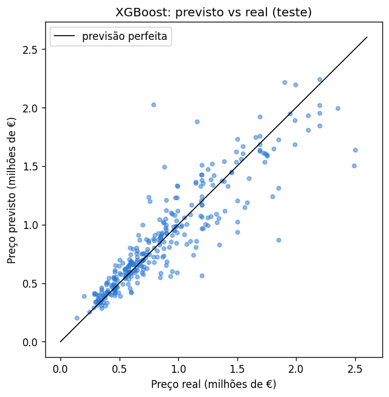
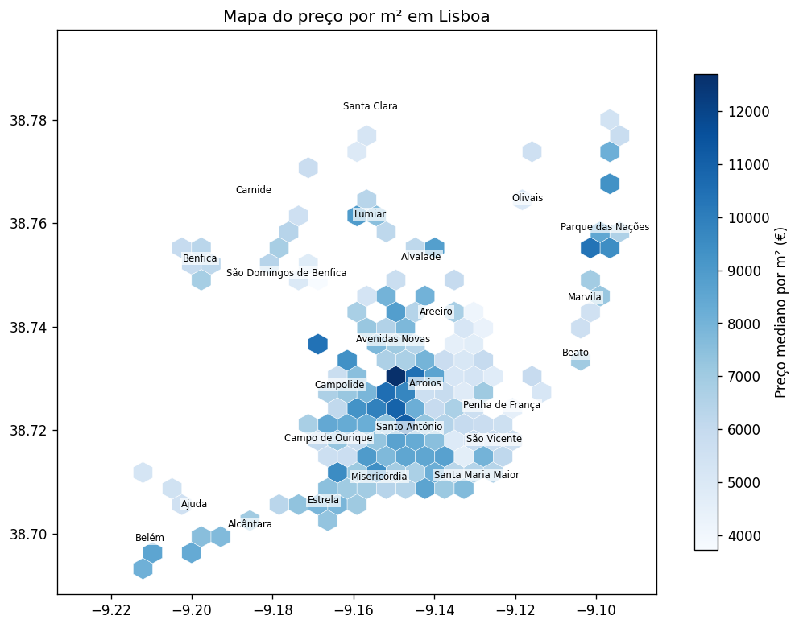
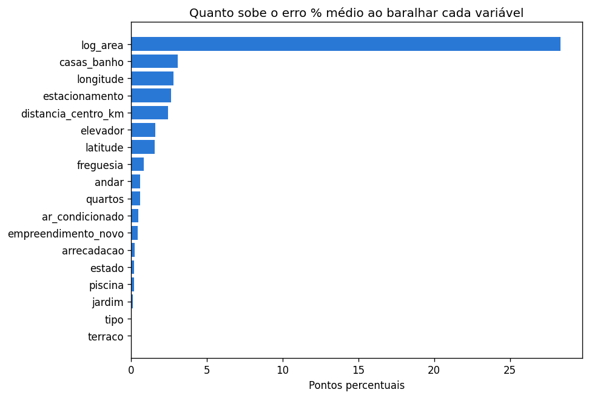

# Previsão de preços de apartamentos em Lisboa

Projeto pessoal de Machine Learning: estimar o preço pedido de um apartamento em Lisboa a partir da área, localização, quartos, casas de banho, estado e extras. Usa 1 553 anúncios reais de um só dia (80% para treinar e 20% para testar), em Python (pandas, scikit-learn, XGBoost, Matplotlib).

## Resultado

O modelo escolhido (XGBoost) erra em média 14,7% do preço e cerca de 11% numa casa típica, em casas que nunca viu. Uma regra simples (área × preço mediano por m² da freguesia) erra 22,5%.

| Modelo | Erro % médio (MAPE) | Erro % mediano | Casas com erro abaixo de 10% | Erro médio | RMSE |
|---|---|---|---|---|---|
| Regra simples | 22,5% | 18,3% | 34% | 190 mil € | 287 mil € |
| Regressão Linear Múltipla | 16,4% | 12,9% | 39% | 146 mil € | 225 mil € |
| XGBoost (escolhido) | 14,7% | 11,2% | 48% | 130 mil € | 206 mil € |
| Random Forest | 14,4% | 10,3% | 49% | 127 mil € | 206 mil € |

No teste, o Random Forest ficou ligeiramente melhor do que o XGBoost (14,4% contra 14,7%). A escolha foi feita antes, com validação cruzada nas casas de treino (XGBoost 14,5%, Random Forest 14,9%, Regressão Linear Múltipla 15,9%); o teste serve só para medir o erro final.

Em 80% das casas de teste, o preço real ficou entre 80% e 125% da estimativa. É esta a margem usada para dar um intervalo em cada previsão.



O preço por m² muda muito com a localização: é mais alto no centro e no Parque das Nações.



A área é o que mais pesa no preço, seguida das casas de banho, da localização e do estacionamento.



## Notebooks

| Notebook | O que faz |
|---|---|
| [01_limpeza](notebooks/01_limpeza.ipynb) | Escolhe as colunas úteis e corrige erros |
| [02_exploracao](notebooks/02_exploracao.ipynb) | Distribuição dos preços, mapa de preços e matriz de correlação |
| [03_feature_engineering](notebooks/03_feature_engineering.ipynb) | Casas de luxo, log da área, distância ao centro e one-hot encoding |
| [04_modelos](notebooks/04_modelos.ipynb) | Treino/teste e comparação de três modelos com validação cruzada |
| [05_avaliacao](notebooks/05_avaliacao.ipynb) | Erro no teste, importância das variáveis e margem de erro |
| [06_previsao](notebooks/06_previsao.ipynb) | Estimar o preço de uma casa, com intervalo provável e preço por m² |

## Decisões principais

- O modelo aprende o logaritmo do preço e o erro é medido em %: errar 10% numa casa de 300 mil € conta o mesmo que errar 10% numa de 2 milhões.
- Casas acima de 2,5 milhões ficam de fora (4% dos anúncios).
- O modelo é escolhido com validação cruzada (5 grupos) nas casas de treino; o teste (20%) só é usado no fim, para medir o erro.

## Limitações

- Estima o preço pedido nos anúncios, não o preço de venda.
- Os dados são de um só dia e não têm a idade do prédio, a vista ou os acabamentos.
- Casas invulgarmente baratas para as suas características tendem a sair estimadas a mais.

## Como correr

```bash
pip install -r requirements.txt
```

Pôr um ficheiro de anúncios `dataset_*.csv`, com as colunas usadas no notebook 01, em `data/raw/` e correr os notebooks pela ordem, de 01 a 06. Os dados não estão incluídos no repositório.
