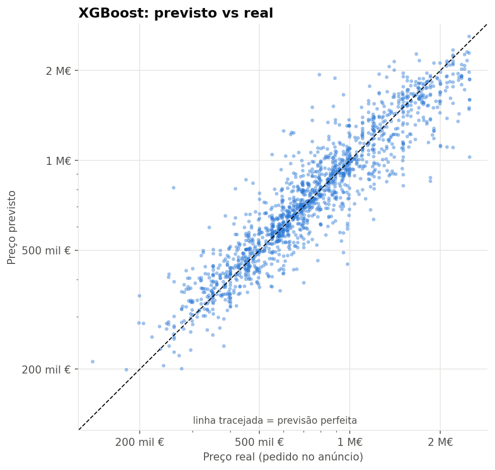
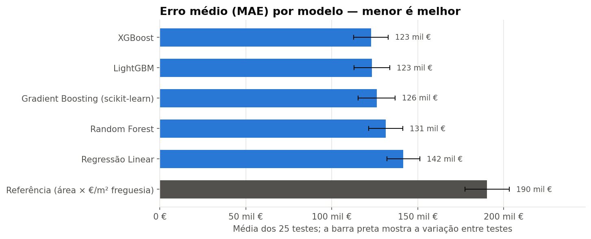
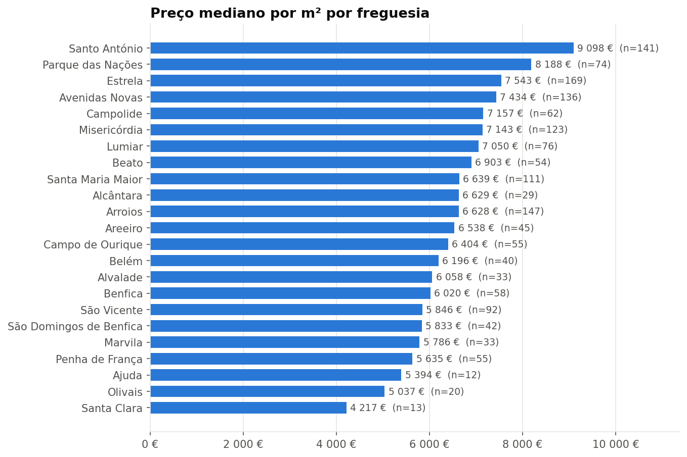
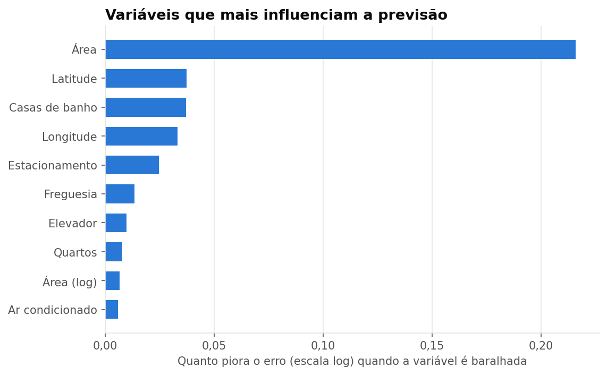

# Previsão de preços de apartamentos em Lisboa

Modelo de Machine Learning que estima o preço pedido (preço de anúncio) de apartamentos à venda em Lisboa a partir da área, localização, tipologia, estado, andar e alguns extras. Foi treinado com cerca de 1 500 anúncios reais.

O melhor modelo (XGBoost) tem um erro médio de cerca de 123 mil €, explica 83% da variação dos preços (R²) e fica a menos de 10% do preço real em cerca de metade das casas. Face a uma estimativa simples (área × preço/m² mediano da freguesia), o erro médio desce cerca de 35%.



## Dados

Anúncios públicos de apartamentos à venda no concelho de Lisboa (24 freguesias), recolhidos a 12/10/2026. Dos 1 661 anúncios iniciais ficaram 1 623 depois da limpeza e 1 553 dentro do âmbito do modelo (apartamentos até 2,5 M€).

Os dados não estão incluídos no repositório, nem os brutos nem os limpos, e os notebooks mostram apenas estatísticas agregadas. O ficheiro [data/README.md](data/README.md) explica como reproduzir o projeto com outros dados.

Variáveis usadas: área, quartos, casas de banho, andar, freguesia, latitude e longitude, tipo de imóvel (apartamento, duplex, cobertura, estúdio), estado (novo, bom, para recuperar) e extras (elevador, estacionamento, terraço, piscina, jardim, ar condicionado, arrecadação).

## Notebooks

| Notebook | Conteúdo |
|---|---|
| [01_limpeza_dados](notebooks/01_limpeza_dados.ipynb) | Seleção de colunas e remoção de dados pessoais, valores impossíveis e anúncios duplicados |
| [02_analise_exploratoria](notebooks/02_analise_exploratoria.ipynb) | Distribuição de preços, preço/m² por freguesia e por estado, efeito dos extras |
| [03_modelacao](notebooks/03_modelacao.ipynb) | Comparação de seis abordagens com validação cruzada repetida |
| [04_previsao](notebooks/04_previsao.ipynb) | Estimativa do preço de um apartamento, com intervalo provável |

Cada notebook explica as decisões em texto e o código está comentado. A configuração partilhada (pastas, variáveis, estilo dos gráficos) está em `src/utils.py`.

## Metodologia

- O modelo prevê o logaritmo do preço. Como os preços têm uma cauda longa, isto faz com que o modelo minimize erros percentuais em vez de absolutos.
- As casas acima de 2,5 M€ (4% dos anúncios) ficam de fora. Um teste no notebook 03 mostra que excluí-las do treino reduz o erro nas restantes em cerca de 7% (melhor em 24 de 25 testes).
- A avaliação usa validação cruzada repetida (5 grupos × 5 repetições = 25 divisões treino/teste), o que dá resultados mais estáveis e uma medida da variação entre testes.
- Os modelos são comparados nas mesmas divisões, contando quantas vezes cada um tem menor erro que o outro.
- O preço por m² não é usado como variável, porque é calculado a partir do preço, e os anúncios duplicados são removidos antes da modelação.

## Resultados

Média de 25 testes em casas que o modelo não viu durante o treino (apartamentos até 2,5 M€):

| Modelo | Erro médio (MAE) | RMSE | R² | Erro % mediano | Casas com erro < 10% |
|---|---|---|---|---|---|
| Referência (área × €/m² da freguesia) | 190 mil € | 286 mil € | 0,65 | 17,6% | 32% |
| Regressão Linear | 142 mil € | 222 mil € | 0,79 | 12,3% | 42% |
| Random Forest | 131 mil € | 213 mil € | 0,80 | 10,1% | 50% |
| Gradient Boosting (scikit-learn) | 126 mil € | 202 mil € | 0,82 | 10,2% | 49% |
| XGBoost | 123 mil € | 197 mil € | 0,83 | 9,8% | 51% |
| LightGBM | 123 mil € | 197 mil € | 0,83 | 10,0% | 50% |



Os modelos baseados em árvores ganham à regressão linear porque captam interações, por exemplo o facto de o valor de um m² depender da zona. O XGBoost teve menor erro do que o Gradient Boosting do scikit-learn em 23 de 25 testes, mas por pouco (cerca de 3 mil €). Contra o LightGBM o resultado é praticamente um empate (15 de 25).

Em 80% dos casos, o preço real fica entre 80% e 127% da estimativa. Por exemplo, para um T2 de 90 m² em Arroios, num 3.º andar com elevador e em bom estado, o modelo estima cerca de 592 mil € (intervalo provável entre 475 e 749 mil €).

## Principais conclusões



- A localização pesa muito: o m² em Santo António (cerca de 9 100 €) custa mais do dobro do de Santa Clara (cerca de 4 200 €).
- A área é a variável mais importante para o modelo, seguida da localização. Sem freguesia e coordenadas, o erro sobe cerca de 27%. Depois vêm as casas de banho e o estacionamento.
- Um empreendimento novo pede cerca de 26% mais por m² do que um imóvel em bom estado.
- Piscina, terraço e jardim pesam pouco no modelo. Estão associados a preços mais altos, mas sobretudo porque aparecem em casas novas e em zonas caras (metade das casas com piscina são empreendimentos novos), e faltam em cerca de 40% dos anúncios.



## Limitações

- O modelo estima o preço pedido, não o preço de escritura, que costuma ser mais baixo.
- Os dados são de um único dia e correspondem aos primeiros resultados de uma pesquisa, por isso podem estar inclinados para imóveis mais caros do que o mercado no seu conjunto.
- Não cobre casas acima de 2,5 M€ e é menos fiável nas freguesias com poucos anúncios (Carnide, Ajuda, Santa Clara).
- Faltam variáveis relevantes, como a idade do imóvel, o certificado energético ou as vistas.
- Frações semelhantes do mesmo prédio, comuns em empreendimentos novos, podem ficar uma no treino e outra no teste, o que torna os resultados ligeiramente otimistas. Num teste em que as casas do mesmo prédio ficam sempre do mesmo lado, o erro médio sobe de cerca de 123 para 132 mil €.

## Como executar

Requer Python 3.10 a 3.13 (as versões fixadas em `requirements.txt` ainda não têm instalador para o Python 3.14).

```bash
git clone https://github.com/pedr0miguel02/previsao-precos-casas-lisboa.git
cd previsao-precos-casas-lisboa
python -m venv .venv
.venv\Scripts\activate          # Windows (macOS/Linux: source .venv/bin/activate)
pip install -r requirements.txt
jupyter notebook notebooks/
```

Antes de correr os notebooks é preciso colocar um ficheiro de dados em `data/raw/` (ver [data/README.md](data/README.md)). Os notebooks correm pela ordem, de 01 a 04. O notebook 03 demora cerca de 2 minutos.

```
├── data/              dados (não incluídos)
├── models/            modelo treinado (criado pelo notebook 03)
├── notebooks/         os quatro notebooks
├── reports/           gráficos e métricas dos modelos
├── src/utils.py       configuração e funções partilhadas
└── requirements.txt
```

## Próximos passos

- Recolher dados ao longo do tempo para aumentar a amostra e acompanhar a evolução dos preços.
- Extrair variáveis do texto dos anúncios (por exemplo, "vista rio" ou "remodelado").
- Comparar com os preços de transação do INE por freguesia, para medir a diferença entre preço pedido e preço de venda.

## Tecnologias

Python, pandas, NumPy, scikit-learn, XGBoost, LightGBM, Matplotlib e Jupyter.

## Licença

O código está disponível sob a licença [MIT](LICENSE). Os dados não estão incluídos e não são abrangidos por esta licença.
